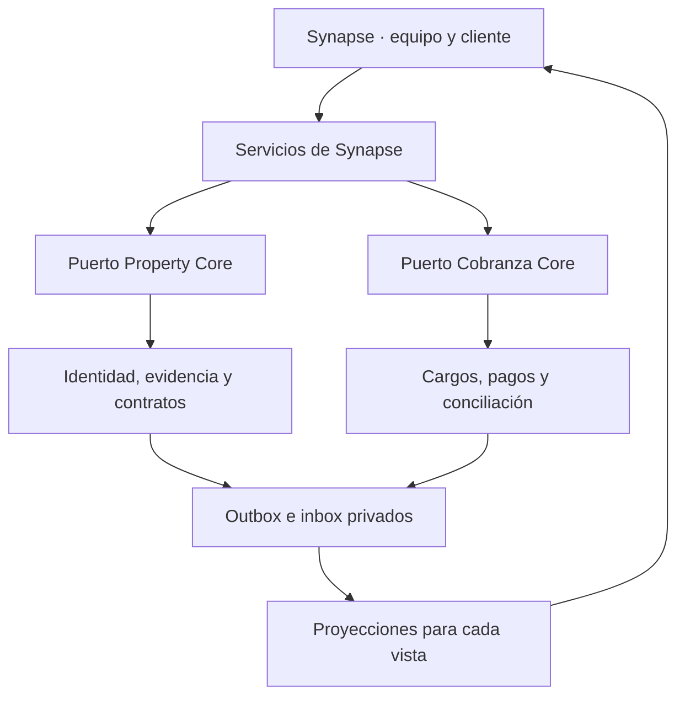

# Synapse, Property Core y Cobranza Core — arquitectura de consumo V0.1

Estado: preparación de contratos y consumidores puros, sin transporte ni activación productiva. No es una API desplegada. La versión actual de Synapse mantiene RTDB; Cobranza tiene un adaptador Firestore servidor en laboratorio. No se propone convertir una base en espejo completo de la otra.

## Fuentes comprobadas

- Synapse: rama `lab/attention-continuity-v01`, referencia de auditoría `6bdd40e106168f1b00b746f1945a33d3745b19bd`.
- Property Core: `core-contracts/property`, coincidente con la base de identidad y evidencia de `lab/property-core-integration-pc-g5` en `d22fe8dd514681d69438adce041c65444a4f0ae6`. Identidad compuesta, estado operativo, evidencia y bitácora; no se encontró en esa rama un servicio productivo que publique activación de contratos.
- Cobranza Core: repositorio `petronasbeats-hash/cobranza-core`, rama **lab/cobranza-core-v0.1**, commit `57bc1406e35e114d058f8db8139d440df26b0618`. `main` solo contiene README y .gitignore. Se revisaron AGENTS, límites, decisiones, persistencia, dominio, puerto, adaptador y consumidor de activación. Su documentación registra 27 pruebas rápidas y 12 de emulador en CI; esos resultados pertenecen a aquel repositorio y no se reejecutaron en esta auditoría. El gate publicado es NO-GO para dinero real.

La búsqueda de contexto conversacional previo no estuvo disponible; estas decisiones distinguen contratos encontrados de propuestas nuevas. No se copió la implementación financiera privada al repositorio público de Synapse.

## Responsabilidad y consumo

| Dominio | Autoridad propuesta/conservada | Consumo en Synapse |
|---|---|---|
| Personas, alias, fuente, canal, atención y próxima acción | Synapse | Directorio, Atención, Radar y bitácora |
| Especificación e identidad de inmuebles/unidades, condición física, evidencia, ocupación y contrato/renovación | Property Core | Inmuebles operativo, ficha autorizada de Reservar, contexto en Atención y Agenda |
| Publicación y presentación comercial | Capa comercial de Synapse sobre la identidad de Property Core | Borrador/publicado, fotos/texto revisados y ficha compartida cliente/equipo |
| Visitas, firmas, actividades y ocupación de horarios | Agenda, coordinada por Synapse | Reservar y Atención solicitan al mismo gateway; Property no confunde cita con contrato |
| Cargos, pagos, aplicaciones, depósitos, recibos y conciliación | Cobranza Core | Resumen financiero privado, acciones de revisión y referencias; nunca edición de saldos desde Radar |
| Documentos y evidencia documental | Referencias a BUNKER / puerto documental futuro | Solicitud y revisión por rol, sin copiar INE/comprobantes al catálogo público |

Los puertos, inbox/outbox y proyecciones de este diagrama son arquitectura a conectar, no infraestructura ya desplegada. El navegador no recibe SDK administrativo, credenciales entre motores ni acceso financiero de escritura.

## Identidades y relaciones

- Cada consulta/mutación exige organizationId obtenido de autorización servidor; no se confía en una organización enviada por el navegador.
- Contacto: contactId actual de Directorio. Una persona puede ser vendedor, propietario, arrendador, inquilino o proveedor en operaciones diferentes.
- Inmueble comercial: propiedadId actual. Property Core usa además propertyGroupId + unitId bajo organizationId; su `createOperationalUnitId` devuelve `JSON.stringify([propertyGroupId, unitId])`. Ese valor NO es global sin la organización.
- Las propiedades tradicionales o antiguas sin identidad completa quedan «pendiente de vinculación». No se inventa una unidad «principal», ni se resuelve por nombre/dirección.
- La tabla privada de enlaces debe conservar source, sourceId, organizationId, canonicalRef, revision, responsable y evidencia de vinculación. No se renumeran citas o inmuebles existentes.
- Operación comercial y contrato son entidades distintas. operationRef conserva ownerContactId + operationId; contractId lo asigna/valida la autoridad contractual de Property Core.
- Una cita/folio RSV no es un contrato ni un cargo. La firma o entrega es una evidencia por evaluar; nunca equivale por sí sola a activación jurídica/financiera.
- El adaptador financiero actual no guarda contractId/tenantRef en todos los pagos/depósitos/cargos. Se necesita un enlace privado verificable entidad financiera → contrato/unidad/persona antes de mostrar totales «de ese contrato». No agrupar por nombre, importe o teléfono.

## Puertos y código preparado

`server/integrations/core-consumption.cjs` es un módulo servidor desacoplado, NO importado por attentionApi ni por los bundles públicos:

1. `assessPropertySnapshot`: reutiliza la identidad y el evaluador existentes de Property Core. Exige identidad inequívoca, organización y políticas de vigencia explícitas. Conserva inmuebles no publicados en el inventario interno. No convierte `inventario.disponible` en evidencia, no infiere ocupación ni habilita visitas por sí mismo.
2. `previewBillingActivation`: valida el evento plano que el consumidor existente de Cobranza conoce, verifica su enlace y exige un puerto de autorización externa y un mapper inyectado. Solo devuelve preview, con dispatchAllowed:false; no llama createCharge.
3. `normalizeBillingNotification`: adapta explícitamente los eventos actuales del dominio y persistencia de Cobranza, filtra referencias y pide consulta a la autoridad. Un pago registrado o recibo emitido nunca se transforma en «liquidado» por este consumidor.
4. `decideInbox`: decisión pura de duplicado/conflicto por organización + origen + eventId + fingerprint. No es persistencia ni garantía de entrega exactamente una vez. Un repositorio futuro deberá guardar recibo/proyección en una misma transacción y controlar leases/reintentos.

scope.permissions en estas funciones es un contexto de servidor ya autenticado. Su forma estructural no verifica tokens ni firmas. `verifyAuthorization` debe consultar la autoridad real de Property Core; una etiqueta «verified» aportada por el usuario no es suficiente. Los umbrales de vigencia usados en tests son fixtures; no fijan una política comercial productiva.

## Eventos existentes y diferencias detectadas

Property operativo v0.1 tiene maintenance_started, maintenance_updated, inspection_recorded, verification_completed y unit_status_changed con actor/evidenceRef; no deben rebautizarse como contratos activados.

Cobranza define/consume `property.contract.activated.v1` con schemaVersion:1 y estos campos planos: eventId, organizationId, contractId, tenantRef, unitRef, rentAmountMinor, currency, effectiveAt y authorizationRef. Renovación/terminación constan en límites como propuestas; no se afirma que tengan consumidor implementado.

Brechas antes de activar:

- El mapper de activación actual usa effectiveAt para period/dueAt, no aplica billingSchedule ni maneja calendario civil de cobro por organización. Cerca de medianoche, una fecha UTC puede caer en otro día/mes en México. El preview mantiene bloqueos por calendario/cadencia sin resolver.
- El consumidor exige authorizationRef como texto, pero eso no autentica el publicador ni prueba autorización. Hace falta verificación servidor y mensaje de contrato completo/versionado.
- El adaptador persistente publica los eventos con data.entityId para cargos/pagos/depósitos; el dominio en memoria usa data.chargeId/paymentId/depositId. El nuevo normalizador exige sourceVariant explícito; no adivina el esquema.
- Los eventos persistentes no incluyen en todos los casos correlationId, contractId, secuencia de agregado o causationId. Se conserva el evento original y se añade metadata de transporte aparte. No se inventan esos campos ni se ordenan saldos por occurredAt.
- La política comercial de «depósito no reembolsable compensado con ocupación» no se mapea automáticamente al depósito held de garantía del motor. Necesita clasificación y operación explícitas, importe/periodo acordados y evidencia. Nunca se trata como renta cobrada por inferencia.

Cobranza publica billing.charge.created.v1, billing.payment.recorded.v1, billing.deposit.recorded.v1, billing.payment.applied.v1, billing.receipt.issued.v1 y billing.allocation.reversed.v1 en los componentes revisados. Recibo es NON_FISCAL y acredita el pago registrado, no liquidación de todos los cargos.

## Transporte y recuperación a implementar

- Mutación y evento del motor propietario deben comprometerse atómicamente. Su outbox reintenta; el receptor valida origen, versión, autorización, organización y referencias antes de admitir el evento.
- Inbox persistente por organización/origen/eventId; el mismo ID con contenido distinto va a revisión. La proyección lleva cursor y versión de la fuente, no se sobrescribe con un evento atrasado.
- Si falta enlace o autoridad, se registra «requiere revisión» y se genera una sola acción para el responsable. Nunca saldo cero, unidad disponible o contrato activo por ausencia de datos.
- Una notificación financiera solicita lectura autoritativa; la API de resumen por contrato aún no aparece en el puerto persistente revisado. Debe implementarse en Cobranza y devolver fecha de cálculo, moneda, referencias y revisión.
- Synapse genera comandos idempotentes; Property/Cobranza autorizan y deciden. Los errores de una proyección no repiten una mutación financiera confirmada.
- Separar catálogo público (allowlist de ficha) de proyecciones privadas de contratos, pagos, contactos y documentos. Los eventos privados no se publican como propiedades ni se devuelven al cliente invitado.

## Recorridos de consumo

**Consulta/visita:** Reservar/Atención leen la proyección pública revisada; Agenda comprueba horario/ocupación en un gateway único. La respuesta de cliente actualiza la próxima acción privada, no el estado físico o financiero.

**Renta:** Synapse reúne participantes/requisitos y coordina firma. Property verifica y activa el contrato; solo entonces emite la activación autorizada. Cobranza crea los cargos según calendario validado e idempotencia. Sus eventos refrescan el resumen privado y las acciones del responsable. Un contrato vencido no libera una unidad automáticamente.

**Mantenimiento:** Synapse coordina al proveedor; Property recibe la evidencia y decide condición/visitas/entrega. Cotización o cita de servicio no certifica reparación. Cobranza solo interviene en obligaciones financieras explícitamente autorizadas.

**Venta:** Synapse coordina compradores/vendedores/propuesta/firma; Property registra el ciclo autorizado. No se inventa una renta recurrente, comisión cobrada ni factura por cerrar el pipeline.

## Fases y aceptación

1. Resolver identidad, matriz de permisos y referencias; respaldo/restore, consistencia de reservas y auditoría pendientes.
2. Solo lectura: ficha operativa de Property y resumen financiero confirmado de Cobranza. Estados conectado/no conectado/desactualizado y origen visibles.
3. Inbox/outbox durable y replay con eventos sintéticos en staging; probar tenancy, duplicados, desorden, discrepancia, caída tras commit y recuperación.
4. Comandos contractuales/financieros solo tras los gates propios de cada motor, calendario y política de depósito resueltos. El permiso de atender una conversación no concede permiso de registrar pagos o activar contratos.
5. Automatización, métricas y alertas con evidencia. No desplegar otro menú separado para cada motor: consumirlos desde Inmuebles, Directorio, Atención, Agenda y Radar según permiso.
